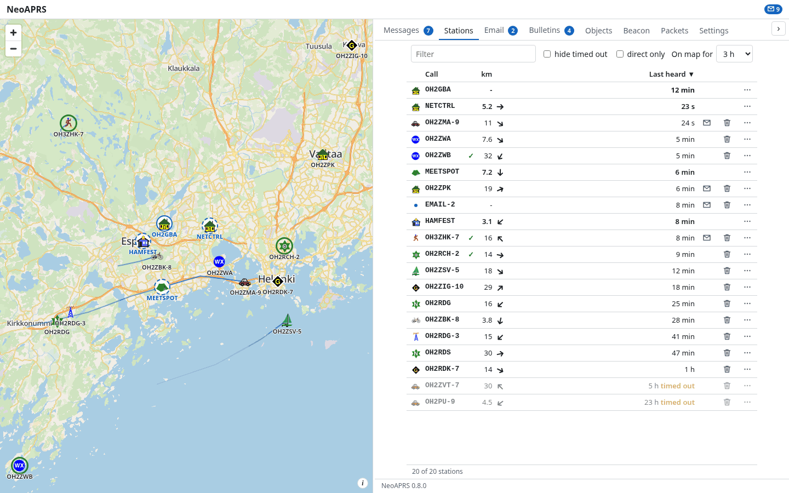
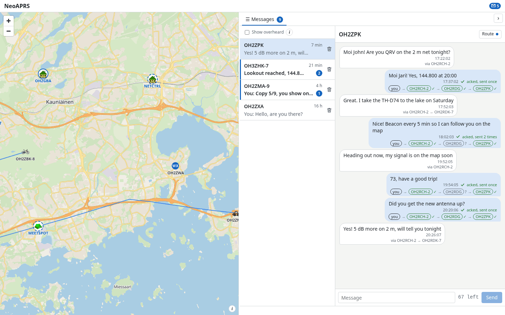

# NeoAPRS

A modern, easy-to-use APRS client for a radio with a TNC.

**The project page is at https://oh2gba.github.io/neoaprs/** — screenshots, downloads and what NeoAPRS does.

NeoAPRS is a map, your messages and your beacon in one page. It runs as an app on Windows and Linux, or as a service on a Raspberry Pi that you open from your laptop or phone. It is RF first: it talks to your radio or TNC, and an optional receive-only iGate puts what the radio hears on APRS-IS. Nothing from the internet is ever sent on the air.

|  |  |
|---|---|

## Download

- Windows: [NeoAPRS-Setup.exe](https://github.com/oh2gba/neoaprs/releases/latest/download/NeoAPRS-Setup.exe) (no administrator rights needed; SmartScreen may warn about an unsigned installer: **More info**, **Run anyway**)
- Linux: [NeoAPRS-x86_64.AppImage](https://github.com/oh2gba/neoaprs/releases/latest/download/NeoAPRS-x86_64.AppImage): make it executable and run it
- Raspberry Pi, Debian, Ubuntu: the `.deb` of the [latest release](https://github.com/oh2gba/neoaprs/releases/latest): `sudo apt install ./neoaprs_<version>_arm64.deb`, then `neoaprs service install --linger`
- Linux, macOS, Raspberry Pi: `curl -LsSf https://github.com/oh2gba/neoaprs/releases/latest/download/install.sh | sh`

Then run `neoaprs open`, or open <http://127.0.0.1:7303/>; a setup guide of five steps (call, position, symbol, radio, map) starts. Nothing is transmitted until a call is set. No radio yet? The radio type **Dummy** makes up traffic to try NeoAPRS with. Installing, updating and removing: [the manual](docs/manual/install.md).

## What it does

- a map of the stations you hear, with trails, weather graphs and a Nearby tab for digipeaters, iGates and voice frequencies in range
- messages with acks and retries, bulletins, and email through the APRS gateway
- your beacon: fixed, or following a GPS with SmartBeaconing for a car, a bicycle, a walker or a boat
- objects and items of your own, on the map and on the air
- an optional fill-in digipeater and an optional receive-only iGate
- a page for a phone, a tablet and a desktop, in English, German, Spanish, French, Italian, Japanese and Brazilian Portuguese
- alerts for a new message, and access from your home network with an access key

## Radios

Kenwood TH-D7, TM-D700, TM-D710, TH-D72, TH-D74 and TH-D75, Mobilinkd, NinoTNC, TNC-Pi, Kantronics KPC-3+, Bluetooth radios such as the BTech UV-PRO, and any radio with a sound-card interface through Direwolf; a GPS through gpsd or a serial port. [The radio guide](docs/RADIOS.md) has the setup of each and says which are tried on the air.

## Getting help

In the page, *Settings*, *Help*, **Download logs** makes one file to e-mail to neoaprs@oh2gba.eu with a few words on what happened ([Getting help](docs/manual/support.md)). Nothing is sent by itself.

## More

[Manual](docs/manual/README.md) · [Radios](docs/RADIOS.md) · [Changelog](CHANGELOG.md) · [Development](docs/development.md) · [Roadmap](ROADMAP.md) · [Issues](https://github.com/oh2gba/neoaprs/issues)

Licence: GPL-3.0-or-later ([LICENSE](LICENSE)). Map data © OpenStreetMap contributors via Protomaps; APRS symbols by Heikki Hannikainen OH7LZB; device names from the APRS device identification list by Hessu, OH7LZB (CC BY-SA 2.0).
