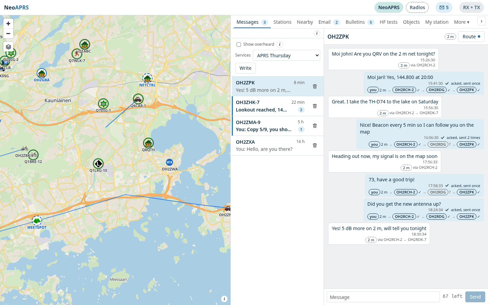

# NeoAPRS

Switch on the radio, open NeoAPRS, and the stations round you come onto the map: the club's digipeater on the hill, a car on the ring road, a weather station by the sea. Write to one of them and watch the message hop from digipeater to digipeater until its ack comes back.

NeoAPRS is an APRS station program for radio amateurs. It runs on Windows, macOS, Linux and the Raspberry Pi, as a desktop app or as a service next to the radio that you open from a laptop, a tablet or a phone. Your radios come first: stations from the internet can be put on the map with one tick, and nothing from the internet is ever sent on the air.

**Project page: [neo.oh2gba.eu](https://neo.oh2gba.eu)**, with screenshots and downloads.

|  |  |
|---|---|

## Download

- Windows: [NeoAPRS-Setup.exe](https://github.com/oh2gba/neoaprs/releases/latest/download/NeoAPRS-Setup.exe) (no administrator rights needed; SmartScreen may warn about an unsigned installer: **More info**, **Run anyway**)
- macOS (Apple silicon, macOS 14 or newer): [NeoAPRS-arm64.dmg](https://github.com/oh2gba/neoaprs/releases/latest/download/NeoAPRS-arm64.dmg): drag NeoAPRS to Applications; the first time, right-click it and choose Open (the app is not signed by Apple)
- Linux: [NeoAPRS-x86_64.AppImage](https://github.com/oh2gba/neoaprs/releases/latest/download/NeoAPRS-x86_64.AppImage): make it executable and run it
- Raspberry Pi, Debian, Ubuntu: the `.deb` of the [latest release](https://github.com/oh2gba/neoaprs/releases/latest): `sudo apt install ./neoaprs_<version>_arm64.deb` (amd64 for a PC), then `neoaprs service install --linger`

Each carries its own Python and the Mercury modem, and on Windows and Linux Direwolf for an FM radio on a sound card: nothing else to install.

Then run `neoaprs open`, or open <http://127.0.0.1:7303/>; a setup guide of four steps (call, position, symbol, radio) starts. Nothing is transmitted until a call is set. No radio yet? A Dummy radio makes up the traffic of a station near you (FM, Mercury or LoRa), to try NeoAPRS with. Installing, updating and removing: [the manual](docs/manual/install.md).

## What it does

- **A map** of the stations you hear, with their trails and the route of each packet, on a street map kept on your disk; a station's card says what it runs and where its antenna points, and several open side by side
- **Any number of radios, of any kind**: KISS TNCs on USB, a serial port, Bluetooth or the network; an FM radio on a sound card, its modem built in (Windows, Linux); the Mercury modem, built in, on a radio's sound card; LoRa APRS boards; a Yaesu FTM or a TNC without KISS that only receives. One map and one station book for all of them, each station tagged with the radio that heard it, and each message on the radio that reaches its station
- **Messages** with acks, reply-acks and retries on the specification's schedule, and the delivery chain of each message hop by hop; bulletins and group messages; email through the APRS gateway; an alert on the desktop and in the browser
- **Your beacon**: fixed, or following a GPS (gpsd or a serial port) with SmartBeaconing for a car, a bicycle, a walker or a boat, on the radios you tick; receive only with one tick
- **Nearby**: digipeaters, iGates, voice frequencies and the stations heard direct, nearest first, with the range of a digipeater drawn on the map
- **Objects and items** of your own, placed and moved on the map; Local info, which asks the stations near you for theirs, and a QRU server for yours
- **Layers** on the map: tracks, the ALOHA circle and a locator grid, and aircraft from your own ADS-B receiver (or adsb.fi, adsb.lol) and ships from your own AIS receiver (or Fintraffic in Finnish waters), only on the map and never mixed with APRS
- **Weather** stations with their readings and 24 hour and 7 day graphs
- **APRS over HF**: the waterfall of the channel and the signal of each packet heard, Tune and a keying Test, and **HF tests**, a board on neo.oh2gba.eu where you say when and on which frequency you will be on the air, so that another station can test with you
- **A fill-in digipeater** and a receive-only **iGate**, both optional; the stations of APRS-IS on the map with a tick
- **A page for a phone, a tablet and a desktop**, over the home network with an access key and optional https, in English, German, Spanish, Finnish, French, Italian, Japanese, Dutch and Brazilian Portuguese

## Radios

On FM: Kenwood TH-D7, TM-D700, TM-D710, TH-D72, TH-D74 and TH-D75, Mobilinkd TNC3 and TNC4, NinoTNC, TNC-Pi, TNC-X, Kantronics KPC-3+, TNC-2 clones, Bluetooth radios such as the BTech UV-PRO, PicoAPRS, and any radio with a sound-card interface (Digirig, AIOC, SignaLink) through the Direwolf that comes with NeoAPRS on Windows and Linux, or a Direwolf or UZ7HO's soundmodem of your own; a Yaesu FTM-100, FTM-400 or FTM-500, or a TNC left in its own monitor mode, receive only.

On HF: an SSB radio with a USB sound card or an interface (a Digirig, a SignaLink, the radio's own USB audio) and the [Mercury](https://github.com/Rhizomatica/mercury) modem that comes with NeoAPRS. Only stations on the same modem and frequency hear each other; the suggested frequencies are on the [project page](https://neo.oh2gba.eu/). Read more: [the article](https://neo.oh2gba.eu/aprs-below-the-noise.html), [the one-page summary](https://neo.oh2gba.eu/aprs-over-hf-one-page.html), [the technical note](https://neo.oh2gba.eu/aprs-over-hf-mercury.html) and [the first test on the air](https://neo.oh2gba.eu/first-test.html).

On LoRa: ESP32 boards with the CA2RXU iGate or Tracker, DL9SAU's tracker or esp32_loraprs, on the network, USB or Bluetooth.

A GPS through gpsd or a serial port. [The radio guide](docs/RADIOS.md) has the setup of each and says which are tried on the air; [the manual](docs/manual/radio.md) says what to choose for each.

## Getting help

In the page, *Settings*, *Help*, **Send feedback / logs** sends your words and the logs to the project with one press ([Getting help](docs/manual/support.md)).

Feedback and ideas: the button above first, then [GitHub issues](https://github.com/oh2gba/neoaprs/issues) or [neo@oh2gba.eu](mailto:neo@oh2gba.eu).

## More

[Project page](https://neo.oh2gba.eu) · [Manual](docs/manual/README.md) · [Radios](docs/RADIOS.md) · [Changelog](CHANGELOG.md) · [Development](docs/development.md) · [Roadmap](ROADMAP.md) · [Issues](https://github.com/oh2gba/neoaprs/issues)

Written in Python (asyncio, Tornado, SQLite) and Vue, with a Qt window for the desktop app (pywebview on Windows). Licence: GPL-3.0-or-later ([LICENSE](LICENSE)). Map data © OpenStreetMap contributors via Protomaps; APRS symbols by Heikki Hannikainen OH7LZB; aircraft shapes from tar1090 by Matthias Wirth (GPL-2.0-or-later); device names from the APRS device identification list by Hessu, OH7LZB (CC BY-SA 2.0); airport names from OurAirports (public domain); the HF modem is Mercury by Rhizomatica (GPL-3); the sound-card modem is Direwolf by John Langner, WB2OSZ (GPL-2.0-or-later), which includes software developed by the National Geospatial-Intelligence Agency (GEOTRANS); the QR code by uqr (MIT), after Project Nayuki.
