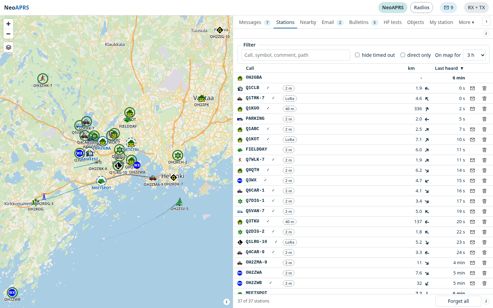

# NeoAPRS

See who is on the air around you, chat with other hams and know your message arrived. Use every radio you have at once: packet on VHF and HF, Mercury and LoRa. No internet needed, and it is free.

NeoAPRS is an APRS client for Windows, macOS, Linux and the Raspberry Pi. It runs as a desktop app, or as a service next to the radio that you open from a laptop, a tablet or a phone.

NeoAPRS is in beta. We are looking for more users and testers: try it and [tell us what you find](mailto:neo@oh2gba.eu).

**Project page: [neo.oh2gba.eu](https://neo.oh2gba.eu)**, with screenshots and downloads.

|  |  |
|---|---|

## Download

- Windows: [NeoAPRS-Setup.exe](https://github.com/oh2gba/neoaprs/releases/latest/download/NeoAPRS-Setup.exe) (no administrator rights needed; SmartScreen may warn about an unsigned installer: **More info**, **Run anyway**)
- macOS (Apple silicon, macOS 14 or newer): [NeoAPRS-arm64.dmg](https://github.com/oh2gba/neoaprs/releases/latest/download/NeoAPRS-arm64.dmg): drag NeoAPRS to Applications; the first time, right-click it and choose Open (the app is not signed by Apple)
- Linux: [NeoAPRS-x86_64.AppImage](https://github.com/oh2gba/neoaprs/releases/latest/download/NeoAPRS-x86_64.AppImage): make it executable and run it
- Raspberry Pi: [neoaprs_arm64.deb](https://github.com/oh2gba/neoaprs/releases/latest/download/neoaprs_arm64.deb); Debian and Ubuntu on a PC: [neoaprs_amd64.deb](https://github.com/oh2gba/neoaprs/releases/latest/download/neoaprs_amd64.deb): `sudo apt install ./neoaprs_arm64.deb`, then `neoaprs service install --linger`

Each carries its own Python and the Mercury modem, and on Windows and Linux Direwolf for a packet radio on a sound card: nothing else to install.

Then run `neoaprs open`, or open <http://127.0.0.1:7303/>; a setup guide of four steps (call, position, symbol, radio) starts. Nothing is transmitted until a call is set. No radio yet? A Dummy radio makes up the traffic of a station near you (Packet, Mercury or LoRa), to try NeoAPRS with. Installing, updating and removing: [the manual](docs/manual/install.md).

## What it does

- **A map** of the stations you hear, with their trails and the route of each packet, on a street map kept on your disk
- **Any number of radios, of any kind**, side by side: one map and one inbox, each station tagged with the radio that heard it
- **Messages** with acks and retries, and the path each message took, hop by hop; bulletins, group messages and email
- **Your beacon**: fixed, or from a GPS with SmartBeaconing; receive only with one press
- **Nearby**: digipeaters, iGates and voice frequencies, nearest first
- **Objects and items** of your own on the map
- **Layers** on the map: the ISS and the APRS satellites with their next pass, aircraft, ships, tracks, the locator grid, and day and night
- **Weather** stations with 24 hour and 7 day graphs
- **APRS over HF** with the Mercury modem built in: the waterfall of the channel, Tune and Test, and **HF tests**, a board where you say when you will be on the air
- **A fill-in digipeater**, digipeating between two of your radios, and an **iGate** with two ticks, Send what I hear and Show Internet stations, all optional
- **A page for a phone, a tablet and a desktop**, in nine languages, with metric or non-metric units

## Radios

Packet on VHF and UHF: any radio with a sound-card interface (Digirig, AIOC, SignaLink), with the APRS modem built in on Windows and Linux; Kenwood TH-D7, TM-D700, TM-D710, TH-D72, TH-D74 and TH-D75; Mobilinkd TNC3 and TNC4; NinoTNC, TNC-Pi, TNC-X, Kantronics KPC-3+, TNC-2 clones and any TNC in KISS mode; Bluetooth radios such as the BTech UV-PRO; PicoAPRS; your own Direwolf or UZ7HO soundmodem; a Yaesu FTM or a TNC without KISS, receive only.

Packet on HF: an SSB radio with a sound-card interface and the 300 baud modem of the Direwolf that comes with NeoAPRS, or a TNC ticked On HF.

Mercury: an SSB radio with a USB sound card or an interface (a Digirig, a SignaLink, the radio's own USB audio) and the [Mercury](https://github.com/Rhizomatica/mercury) modem that comes with NeoAPRS. The suggested frequencies are on the [project page](https://neo.oh2gba.eu/#hf). Read more: [the article](https://neo.oh2gba.eu/aprs-below-the-noise.html), [the one-page summary](https://neo.oh2gba.eu/aprs-over-hf-one-page.html), [the technical note](https://neo.oh2gba.eu/aprs-over-hf-mercury.html) and [the first test on the air](https://neo.oh2gba.eu/first-test.html).

LoRa: ESP32 boards with the CA2RXU iGate or Tracker, DL9SAU's tracker or esp32_loraprs, on the network, USB or Bluetooth.

A GPS through gpsd or a serial port. [The radio guide](docs/RADIOS.md) has the setup of each.

## Getting help

In the page, *Settings*, *Help*, **Send feedback / logs** sends your words and the logs to the project with one press ([Getting help](docs/manual/support.md)).

Feedback and ideas: the button above first, then [GitHub issues](https://github.com/oh2gba/neoaprs/issues) or [neo@oh2gba.eu](mailto:neo@oh2gba.eu).

## More

[Project page](https://neo.oh2gba.eu) · [Manual](docs/manual/README.md) · [Radios](docs/RADIOS.md) · [Changelog](CHANGELOG.md) · [Development](docs/development.md) · [Roadmap](ROADMAP.md) · [Issues](https://github.com/oh2gba/neoaprs/issues)

Written in Python (asyncio, Tornado, SQLite) and Vue, with a Qt window for the desktop app (pywebview on Windows). Licence: GPL-3.0-or-later ([LICENSE](LICENSE)). Map data © OpenStreetMap contributors via Protomaps; APRS symbols by Heikki Hannikainen OH7LZB; aircraft shapes from tar1090 by Matthias Wirth (GPL-2.0-or-later); device names from the APRS device identification list by Hessu, OH7LZB (CC BY-SA 2.0); airport names from OurAirports (public domain); the HF modem is Mercury by Rhizomatica (GPL-3); the sound-card modem is Direwolf by John Langner, WB2OSZ (GPL-2.0-or-later), which includes software developed by the National Geospatial-Intelligence Agency (GEOTRANS); the QR code by uqr (MIT), after Project Nayuki.
