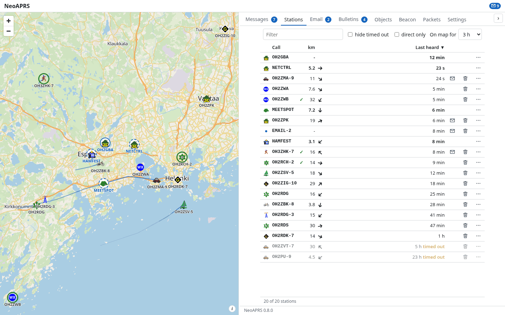
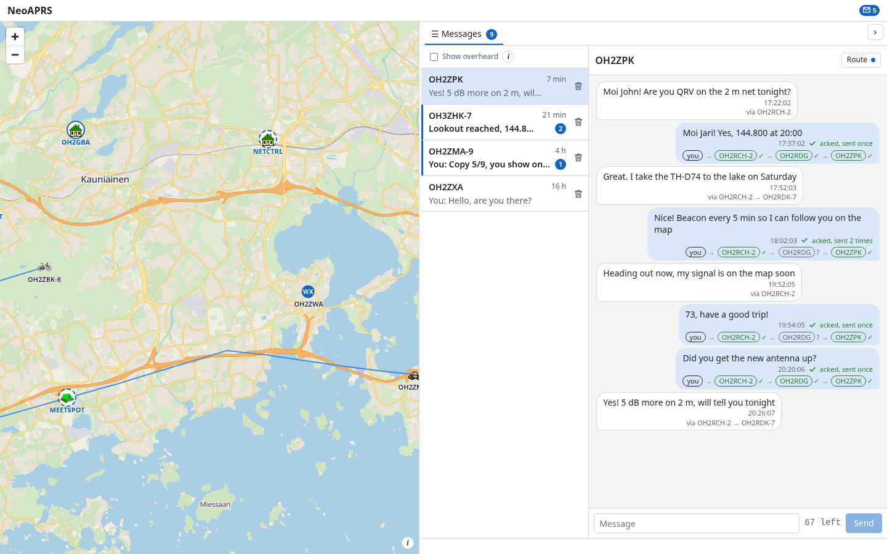

# NeoAPRS

APRS client for Windows, macOS, Linux and the Raspberry Pi. Any KISS TNC on VHF, and APRS over HF with the Mercury modem built in.

**Project page: [neo.oh2gba.eu](https://neo.oh2gba.eu)**, with screenshots and downloads.

NeoAPRS shows the stations you hear on a map, sends and receives APRS messages with acks, and sends your beacon. Run it as a desktop app, or as a service on a Raspberry Pi next to the radio and open it on a laptop, tablet or phone. Your radio comes first: stations from APRS-IS can be added to the map with one tick, and nothing from the internet is ever sent on the air.

**New: APRS over HF.** NeoAPRS is the first to carry APRS over Rhizomatica's Mercury modem: an SSB radio with a sound card, stations 1000 to 2000 km away, messages with acks, and nothing extra to install.

|  |  |
|---|---|

## Download

- Windows: [NeoAPRS-Setup.exe](https://github.com/oh2gba/neoaprs/releases/latest/download/NeoAPRS-Setup.exe) (no administrator rights needed; SmartScreen may warn about an unsigned installer: **More info**, **Run anyway**)
- macOS (Apple silicon, macOS 14 or newer): [NeoAPRS-arm64.dmg](https://github.com/oh2gba/neoaprs/releases/latest/download/NeoAPRS-arm64.dmg): drag NeoAPRS to Applications; the first time, right-click it and choose Open (the app is not signed by Apple)
- Linux: [NeoAPRS-x86_64.AppImage](https://github.com/oh2gba/neoaprs/releases/latest/download/NeoAPRS-x86_64.AppImage): make it executable and run it
- Raspberry Pi, Debian, Ubuntu: the `.deb` of the [latest release](https://github.com/oh2gba/neoaprs/releases/latest): `sudo apt install ./neoaprs_<version>_arm64.deb` (amd64 for a PC), then `neoaprs service install --linger`

Each carries its own Python and the Mercury HF modem: nothing else to install.

Then run `neoaprs open`, or open <http://127.0.0.1:7303/>; a setup guide of four steps (call, position, symbol, radio) starts. Nothing is transmitted until a call is set. No radio yet? The radio type **Dummy** makes up VHF traffic to try NeoAPRS with, and the **Dummy HF radio** makes up distant stations and plays the modem through the speakers. Installing, updating and removing: [the manual](docs/manual/install.md).

## What it does

- **A map** of the stations you hear, with their trails and the route of each packet, on a street map kept on your disk; a station's card says what it runs and where its antenna points, and several open side by side
- **Messages** with acks, reply-acks and retries on the specification's schedule, and the delivery chain of each message hop by hop; bulletins and group messages; email through the APRS gateway; an alert on the desktop and in the browser
- **Weather** stations with their readings and 24 hour and 7 day graphs
- **Nearby**: digipeaters, iGates, voice frequencies and the stations heard direct, nearest first, with the range of a digipeater drawn on the map; frequency objects, storm data and signposts decoded; a QRU server for your objects
- **Your beacon**: fixed, or following a GPS (gpsd or a serial port) with SmartBeaconing for a car, a bicycle, a walker or a boat; receive only with one tick
- **Objects and items** of your own, placed and moved on the map and sent on the specification's schedule, each on FM, on HF or on both
- **APRS over HF** with the Mercury modem, a second radio beside the FM one or on its own: an SSB radio with a sound card, the modem inside NeoAPRS, the sound card and the keying picked for you, Tune and a keying Test, no path (every frame goes direct), the beacon at 30 minutes or more; one map and one station book for both radios, with an FM or HF tag on every station
- **A fill-in digipeater** and a receive-only **iGate**, both optional; the stations of APRS-IS on the map with a tick
- **A page for a phone, a tablet and a desktop**, over the home network with an access key and optional https, in English, German, Spanish, Finnish, French, Italian, Japanese and Brazilian Portuguese
- **The packet log**, every frame with the radio it came on and the path it took; APRS queries from the station menu (position, status, heard direct, trace)

## Radios

On VHF: Kenwood TH-D7, TM-D700, TM-D710, TH-D72, TH-D74 and TH-D75, Mobilinkd TNC3 and TNC4, NinoTNC, TNC-Pi, TNC-X, Kantronics KPC-3+, TNC-2 clones, LoRa APRS (CA2RXU firmware), Bluetooth radios such as the BTech UV-PRO, PicoAPRS, and any radio with a sound-card interface (Digirig, SignaLink) through Direwolf or UZ7HO's soundmodem; a GPS through gpsd or a serial port. [The radio guide](docs/RADIOS.md) has the setup of each and says which are tried on the air.

On HF: an SSB radio with a USB sound card or an interface (a DigiRig, a SignaLink, the radio's own USB audio) and the [Mercury](https://github.com/Rhizomatica/mercury) modem that comes with NeoAPRS. Only stations on the same modem and frequency hear each other; the meeting frequency is 7.0541 MHz USB on 40 m, a proposal until it is confirmed on the air.

## Getting help

In the page, *Settings*, *Help*, **Download logs** makes one file to e-mail to neoaprs@oh2gba.eu with a few words on what happened ([Getting help](docs/manual/support.md)). Nothing is sent by itself.

Feedback and ideas: [GitHub issues](https://github.com/oh2gba/neoaprs/issues) (preferred) or [neoaprs@oh2gba.eu](mailto:neoaprs@oh2gba.eu).

## More

[Project page](https://neo.oh2gba.eu) · [Manual](docs/manual/README.md) · [Radios](docs/RADIOS.md) · [Changelog](CHANGELOG.md) · [Development](docs/development.md) · [Roadmap](ROADMAP.md) · [Issues](https://github.com/oh2gba/neoaprs/issues)

Written in Python (asyncio, Tornado, SQLite) and Vue, with a Qt window for the desktop app. Licence: GPL-3.0-or-later ([LICENSE](LICENSE)). Map data © OpenStreetMap contributors via Protomaps; APRS symbols by Heikki Hannikainen OH7LZB; device names from the APRS device identification list by Hessu, OH7LZB (CC BY-SA 2.0); the HF modem is Mercury by Rhizomatica (GPL-3).
