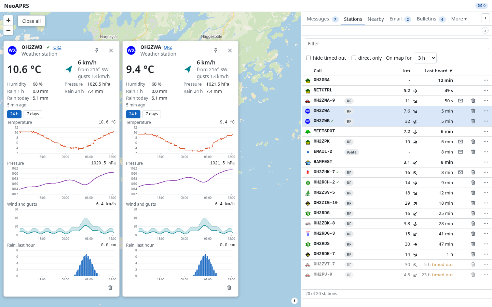
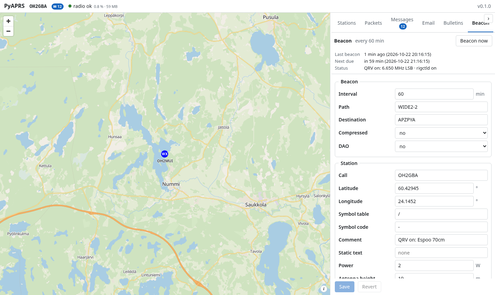
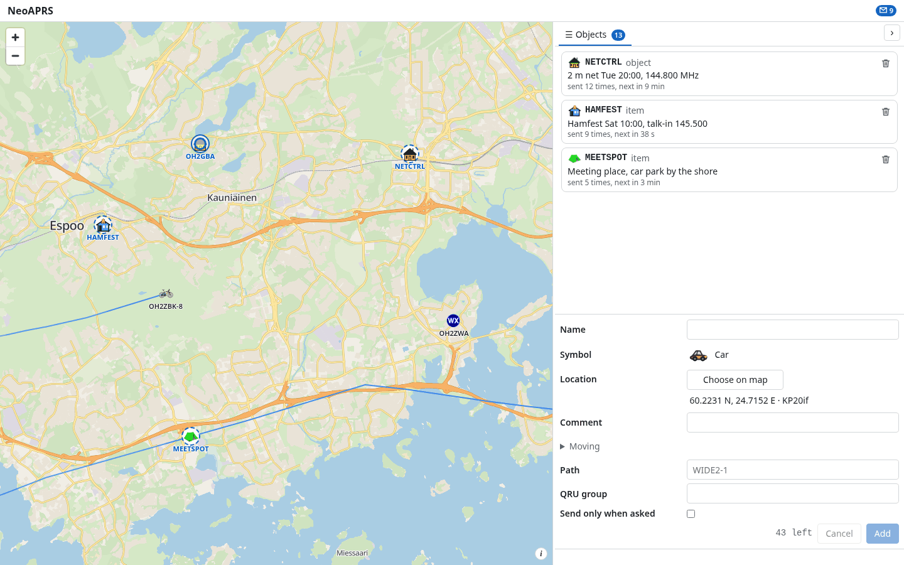
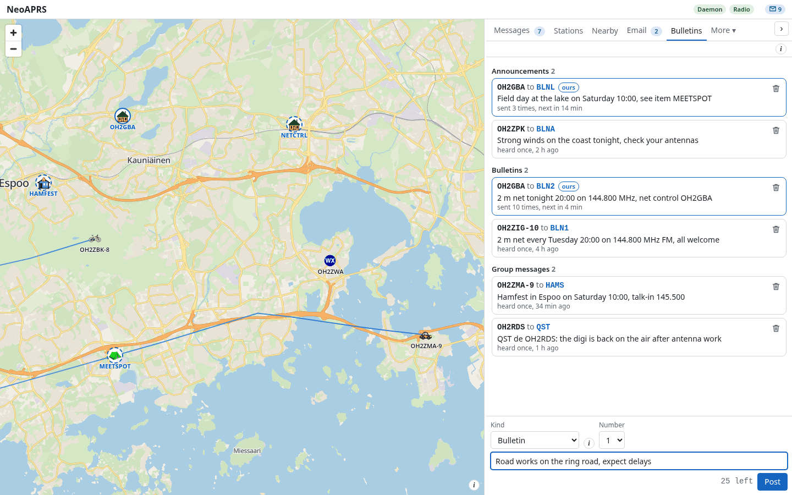
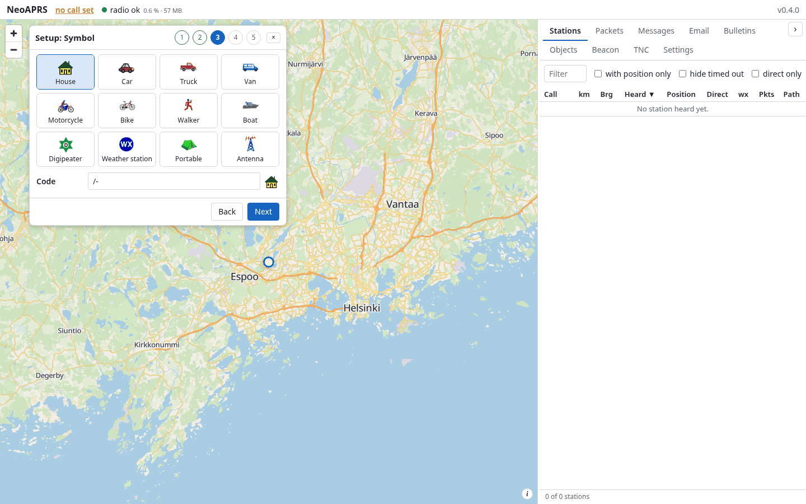

# NeoAPRS

A modern, easy-to-use APRS client: a map of the stations you hear, a Nearby tab that lists the digipeaters, voice frequencies, iGates and stations in simplex range round you, messages with acks and retries (each one chooses its own path), the beacon, weather graphs, objects and bulletins of your own, email through the APRS gateway, and a fill-in digipeater if you want one. It is a standalone app on Windows and Linux (a window with the map and the messages, and a tray icon), or a service you reach over your local network: the radio and NeoAPRS on a Raspberry Pi in the shack, and the page open on your laptop or phone at home. The page fits a phone, a tablet and a desktop, speaks English, German, Spanish, French, Italian, Japanese and Brazilian Portuguese, and a setting applies as you change it; **Language** at the top of the Settings tab changes the page's language. RF only: it talks to your radio or TNC and has no iGate. For the days you only want to listen, **Transmit** in the Beacon tab set to **Receive only** stops all transmitting, and an amber badge in the header says so.

|  |  |
|---|---|
| The map: stations, trails, the ALOHA circle, and the Stations table with **On map for** and a menu for each station (APRS queries included); a station's card says what it runs and how many packets it sent | Weather stations, several cards side by side that you can move, each with its 24 h graphs |
|  |  |
| Messages: the conversations and the open one, acks, retries, the route of each message; one text can go to several stations | The Beacon tab: last beacon, your symbol, the status; a setting applies as you change it |
|  |  |
| Objects and items of your own, on the map and on the air | The message board, with a box to post to it |

## Download and run

Every file is on the [Releases page](https://github.com/oh2gba/neoaprs/releases/latest).

| System | What to get |
|---|---|
| Windows | `NeoAPRS-Setup-<version>.exe`: run it, no administrator rights are needed. SmartScreen may warn about an unsigned installer: **More info**, **Run anyway** |
| Linux | `NeoAPRS-<version>-x86_64.AppImage`: make it executable and run it |
| Raspberry Pi, Debian, Ubuntu | `neoaprs_<version>_arm64.deb` / `_amd64.deb`: `sudo apt install ./neoaprs_<version>_arm64.deb`, then `neoaprs service install --linger` ([the .deb](docs/manual/install.md#raspberry-pi-debian-ubuntu-deb)) |
| Linux, macOS, Raspberry Pi | the install line below: it installs [uv](https://docs.astral.sh/uv/) and NeoAPRS and starts NeoAPRS as a service of your user (systemd on Linux, launchd on macOS) |

```bash
curl -LsSf https://github.com/oh2gba/neoaprs/releases/latest/download/install.sh | sh
```

Then run `neoaprs open`, or open <http://127.0.0.1:7303/>. If the port says *permission denied* on Linux: `sudo usermod -aG dialout $USER`, then log out and in. `neoaprs doctor` says what keeps the radio from working.

When a newer version is out, its number appears in the footer under the panel (on a phone, in the header); a click opens a window with what is new and the steps for the way you installed it. The Windows installer and the AppImage have an **Update now** button there: NeoAPRS downloads the new version from the release, checks its checksum, installs it and restarts. Elsewhere run the newer installer or the install line again (`sudo apt install` the newer .deb). Your data (settings, messages, packets, the map) is not touched, and open pages load the new version by themselves ([Updating](docs/manual/install.md#updating)). To remove: *Settings*, *Apps*, NeoAPRS on Windows; `neoaprs service remove` and `uv tool uninstall neoaprs` elsewhere (`sudo apt remove neoaprs` for the .deb).

## First start

The page opens a setup guide in five steps: **call**, **position** (**Choose on map** and click where you are, or drag the pin; or open **Enter coordinates or locator** and type latitude and longitude in decimal degrees: north and east positive, south and west negative, as Sydney is -33.87, 151.21), **symbol**, **radio**, **map**. Nothing is transmitted until a call is set: until then NeoAPRS only listens. If you do not know the port of your radio, **Find my radio** in the Settings tab (Linux) tries the ports and the usual speeds for you. Once, a few minutes of internet are needed to make the map of your area. Once a day NeoAPRS also asks whether a newer version is out; it sends its version number and the kind of system (Windows, Linux, Raspberry Pi...) and nothing else ([Update check](docs/manual/install.md#the-update-check)).



## Works with

| Radio or TNC | Setup |
|---|---|
| Kenwood TH-D7, TM-D700, TS-2000; TNC-2 clones (MFJ-1270B/1274/1278, TAPR) | [serial, 9600](docs/RADIOS.md#kenwood-th-d7-and-tm-d700) |
| Kenwood TM-D710, TH-D72 | [serial or USB](docs/RADIOS.md#kenwood-tm-d710-and-th-d72) |
| Kenwood TH-D74, TH-D75 | [USB or Bluetooth](docs/RADIOS.md#kenwood-th-d74-and-th-d75) |
| Mobilinkd TNC3, TNC4 | [USB, Bluetooth or Bluetooth LE](docs/RADIOS.md#mobilinkd-tnc3-and-tnc4) |
| BTech UV-PRO, Vero VR-N76, Radioddity GA-5WB (untested) | [Bluetooth](docs/RADIOS.md#btech-uv-pro-vero-vr-n76-radioddity-ga-5wb) |
| PicoAPRS V4 (untested) | [Bluetooth, USB-C or TCP](docs/RADIOS.md#picoaprs-v4) |
| LoRa APRS iGate and Tracker (CA2RXU firmware; untested) | [KISS over TCP or Bluetooth LE](docs/RADIOS.md#lora-aprs-ca2rxu-firmware) |
| NinoTNC, TNC-Pi, TNC-X, any TNC already in KISS | [USB or serial](docs/RADIOS.md#ninotnc) |
| Kantronics KPC-3+ | [RS-232](docs/RADIOS.md#kantronics-kpc-3) |
| Any radio with a sound-card interface (Digirig, SignaLink, USB dongle), through Direwolf or a soundmodem | [KISS over TCP](docs/RADIOS.md#direwolf-sound-card) |

On Linux a Bluetooth radio paired with the computer is picked from the port list by its name, with no extra steps. Yaesu and Icom radios have no KISS TNC for a computer: use a sound-card interface and Direwolf. [The radio guide](docs/RADIOS.md#which-radio-or-tnc-do-you-have) marks which entries are tried on the air and which follow the radios' manuals and users' reports.

## Run it on a Raspberry Pi and open it from home

Put the radio on the Pi, run the install line above on the Pi, and set it up as a service that starts at boot:

```bash
neoaprs service install --linger
```

By default the page answers on the Pi itself only. To reach it from another device: *Settings*, *Web page*, *Allow access from the network*. The page then shows an access key and the addresses to open; open `http://<pi-address>:7303` on the other device and enter the key ([Network access](docs/manual/network.md)). The page alerts you to a new message by itself (a notification or a chime, a switch for each browser in the Settings tab): [Alerts in the page](docs/manual/notifications.md#in-this-browser). An optional secure connection (*Secure connection (https)*, with a certificate NeoAPRS makes itself) lets the page be installed as an app on a laptop or a phone ([Install as an app](docs/manual/network.md#install-the-page-as-an-app)).

## Trying it without a radio

`neoaprs replay` plays a capture as a TNC on a TCP port and prints it. With no file it plays the sample capture that comes with NeoAPRS (three minutes of a TH-D7); `neoaprs capture` records one from your radio:

```bash
neoaprs replay                                                     # prints socket://127.0.0.1:PORT
neoaprs --data demo --port socket://127.0.0.1:PORT --web-port 0    # in another terminal; its log says the page's port
```

## More

- [Radios and TNCs](docs/RADIOS.md): the setup of each, Bluetooth, permissions, troubleshooting
- [Manual](docs/manual/README.md): installing, the first start, the page, the radio, the beacon, messages, email, bulletins, objects, weather, notifications, network access, the settings, the command line
- [Development](docs/development.md): building, the checks, the wire, packaging and releases; [how the daemon behaves](docs/daemon.md)
- [Architecture](docs/ARCHITECTURE.md), [wire protocol](PROTOCOL.md), [changelog](CHANGELOG.md), [roadmap](ROADMAP.md)
- [Issues](https://github.com/oh2gba/neoaprs/issues) and the [project page](https://oh2gba.github.io/neoaprs/)

Licence: GPL-3.0-or-later ([LICENSE](LICENSE)). Map data © OpenStreetMap contributors via Protomaps. APRS symbols by Heikki Hannikainen OH7LZB ([hessu/aprs-symbols](https://github.com/hessu/aprs-symbols)). Device names from the APRS device identification list by Hessu, OH7LZB ([aprsorg/aprs-deviceid](https://github.com/aprsorg/aprs-deviceid), CC BY-SA 2.0).
